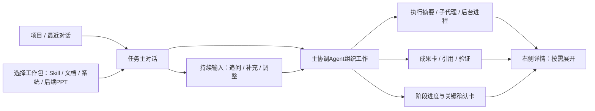

# UI/UX 设计规格：围绕一次工作的对话

JP-1.1｜依据 [PRD](03-prd.md)。[交互设计稿](../design/screenboard.html)使用示例数据；可切换任务、展开执行详情和成果、查看 PPT 扩展情境，不调用真实 Agent。

## 1. 用户只需理解三个概念

**项目**收纳相关工作及材料；**工作**是一段有目标、有交付要求的持续对话；**工作类型**决定这段对话加载什么流程、角色、技能和工具。产品、架构、测试是参与工作的 Agent 身份，不是让用户轮流进入的房间。

应用只有一套主外壳：左侧“新工作”和按项目分组的最近对话；中间是当前工作的主对话和固定输入框；右侧是按需展开的详情。技能库和设置置于侧栏底部。阶段、材料、成果、测试、发布均围绕当前工作就地出现，不再有14个平级标签页。

## 2. 五个界面区域（不是五个平级工作标签）

| ID | 区域 | 如何出现 | 核心职责 |
| --- | --- | --- | --- |
| UI-01 | 开始工作 | 新工作按钮或首次启动 | 目标输入、附件、工作类型建议、启动计划与预算确认；未配模型就地引导 |
| UI-02 | 任务对话 | 默认主界面 | 用户和主协调者消息、计划、阶段、执行摘要、成果与决策卡；持续输入、暂停、继续 |
| UI-03 | 工作详情 | 从对话中的运行/Agent/成果/材料/验证卡点开 | 同一右侧抽屉的上下文视图；可放大成果阅读，保留回到原对话位置 |
| UI-04 | 技能与工作包 | 左下“能力库” | 技能版本与验证、工作包说明/所需能力/可用状态；不在这里开展工作 |
| UI-05 | 设置 | 左下“设置”；缺能力时定向打开 | 模型、搜索/OCR、运行环境、数据/备份、权限与预算；关闭回原任务 |

在1440×900设计基准下，侧栏232px（紧凑窗口208px）；对话内容最大760px居中；详情打开时分配365px，大窗口可扩展420px。最小1100×720，右详情切为覆盖面板，主对话无需横向挤压；Esc关闭并还原焦点。每区独立纵向滚动；输入框始终可达。正文14–16px，不能靠缩小字号容纳更多面板。

## 3. 开始和持续对话

新工作首先提供开放输入：“你想完成什么？”下方可选制作 Skill、写文档、开发系统。工作类型可先不选，模型在用户已配置服务且同意分析调用时建议；也可完全手选。分析请求同样计费和受材料权限限制。首版可先手选类型后调用，不依赖自动分类才能工作。

输入后显示简短启动计划卡：推荐/已选类型、交付物、阶段、角色与技能版本、缺少材料、预算和发送范围。只有用户按“开始工作”才启动执行；未选项目默认应用管理的“未分组项目”，允许重命名。名称1–80字；目标1–20,000字；不先要求用户填一整页表单。

进行中的对话是一条协调者主线。子代理的每个 token 不混入主线；主协调者在开始、产生阶段成果、遇到阻塞、需要决定及完成时更新可核实摘要。用户可展开活动查看细节，不能把聊天逐字稿当成果或基线。

输入框包含附件、工作类型/已锁定工作包、当前协调模型摘要、发送按钮；运行期间显示“补充要求”，并提示补充将在安全边界应用。立即停止通过明确“暂停”按钮处理，不把“发了一条消息”误解为已经打断进程。消息出现收到、排队、已应用或需处理标记，并可跳到应用点。切换项目不会取消工作。

“改成PPT”若发生在已运行文档工作中，协调者解释交付范围变化并提出新工作/变更方案；不原地替换已锁定工作包。尚未开始的草稿可以切换类型。

## 4. 执行可见：看见真实工作，而不是一串‘思考中’

对话内运行摘要例如“工程设计 · 2个Agent正在执行 · 1个等待依赖”，点开执行详情，层级为：主协调者 → 角色任务 → 尝试 → 工具调用 → 实际进程（存在时）。角色名与实际任务名一起显示；未产生进程的模型调用不伪装成终端进程。

默认列出当前活跃节点，其次阻塞，再折叠已完成节点。选择子代理后显示：正在做什么、父任务、依赖、开始/结束时间、当前状态、最后活动、模型配置快照、技能版本、输入基线、已脱敏的活动摘要、工具结果/进程stdout/stderr、已产生的成果、用量与重试次数。需显示任务ID/attemptId时放在复制详情里，不挤占主阅读区域。

用户可以“给这个任务补充要求”“暂停整个工作”“取消此任务分支”“查看成果”。定向补充仍经协调服务审核，不绕过阶段和权限。取消一个子代理不取消兄弟任务，但阻塞依赖它的任务；必要产物缺失时协调者给出重试/调整计划，不能直接完成阶段。重试创建新尝试，旧日志保留。

日志是有来源的操作记录和简短说明，不要求模型输出隐藏思维链。命令、路径、参数先脱敏；查看详细输出不代表可执行任意命令。UI显示最后活动时间；没有活动时写“等待模型返回/等待工具”，不虚构百分比或已消耗token。

## 5. 成果、审批与异常在同一条主线

成果卡显示标题、格式、版本、真实/模拟标识、摘要及审阅状态。点击打开正文/差异/来源；宽内容可放大阅读。材料附件、来源证据、软件测试/业务评测、缺陷和变更影响都作为详情上下文，不需要用户切换业务模块找回任务。

阶段顶部仅显示“现在处于哪一步”和出口条件，点开完整计划。研发仍有research/prd/ux/briefing/engineering/implementation/final-review/release八阶段；不因为聊天界面减少文档和测试门槛。

审批卡必须显示所批准版本、输入基线和影响。普通“好”“继续”可作为方向补充，不能直接当基线批准。生产发布卡独立展示环境、候选摘要、预检、有效授权及回滚；只通过专门按钮提交。新候选需要重新授权。要求修改必须有原因。过期成果可阅读，不能批准。

| 情况 | 原位展示与恢复 |
| --- | --- |
| 初次/无模型 | 保留输入草稿，进入设置后回到原位置；离线可阅读/编辑 |
| 发送失败 | 消息旁重试；相同客户端消息ID幂等，不重复开工 |
| 正在暂停 | 说明已停止派发、在途调用正在结束；服务确认后才写已暂停 |
| 恢复核对 | 对话和成果可读；不确定工具结果标待核实，禁盲目重试 |
| 预算/权限/能力缺失 | 一条可处理阻塞卡，打开具体设置或变更，不清空对话 |
| 基线变化 | 显示补充要求及受影响任务，新的工程改动按原变更规则处理 |
| 流式输出中断 | 保留已落盘片段并标“中断”，不补造剩余文字 |
| 已交付 | 成果集合与验证摘要留在主线；新的需求创建后续工作或正式变更 |

## 6. 原14页去向（迁移映射，不是导航）

| 旧能力 | 新位置 |
| --- | --- |
| 初次设置、模型工具、数据设置 | UI-05；UI-01就地引导 |
| 工作台、新建工作 | UI-01 + 左侧最近对话 |
| 项目概览 | UI-02工作标题、阶段与摘要 |
| 材料来源、成果审阅 | UI-02附件/成果卡 → UI-03预览 |
| 待我处理 | UI-02确认卡；侧栏任务显示需要你处理的徽标 |
| 团队任务 | UI-02执行摘要 → UI-03执行树/子代理详情 |
| 变更影响、验证中心 | UI-02变更/验证卡 → UI-03证据与影响 |
| 技能库 | UI-04能力库 |
| 发布与交付 | UI-02阶段卡和发布确认 → UI-03候选/执行记录 |

## 7. PPT 如何扩展

写PPT是一种新工作包，复用完全相同的对话、阶段、Agent、成果和审阅。包声明“需求→故事线→逐页内容→版式/生成→渲染检查→审阅→交付”，加载调研/叙事/排版/审阅技能，产物增加PPTX与页面预览。生成器和预览能力需要实现并验证；不是只加一句提示词。首版能力库可查看标记为“规划中”的示例，不能启动或导出伪PPTX。详见 [扩展协议](15-conversation-and-extension.md)。

## 8. 键盘及前端验收

Cmd+N新工作；Cmd+Enter发送；Enter默认换行，输入法组合期间禁止误发送；Esc关闭详情并恢复触发点焦点。Tab按阅读顺序，覆盖抽屉/弹层管理焦点；日志默认不自动抢焦点，用户向上阅读后不强制滚到底；新消息用温和计数提示。停止/失败/等待均有文字。200%缩放可阅读，宽表只在自身滚动；禁止快捷键直接批准生产。

组件：ConversationTimeline、Composer、PlanCard、ExecutionSummary、AgentTree、AgentInspector、ProcessLog、ArtifactCard/Preview、DecisionCard、ChangeImpact、UsageMeter、WorkTypePicker。正文、日志长列表虚拟化；200ms内反馈点击/输入状态为目标，模型延迟另列。所有界面状态来源为持久化服务和事件；设计稿演示状态不能当真实执行证据。

## 项目层级澄清（用户确认）

审计项目与护照校验项目为同级项目。审计项目下可有销售穿行、IPO 审计等工作；护照校验系统的工作属于独立的护照校验项目，不放在审计项目下。项目是业务归属，工作类型（制作 Skill、写文档、开发系统等）是执行方式，两者不能混为同一分类。IPO 审计在本稿仅作为归属示例，具体范围与交付要求尚未定义。

## 工作区常驻执行栏（用户补充）

对话上方常驻显示“当前工作 · N个智能体工作中 · M个后台Job”，不随聊天滚动消失。数字按钮可分别打开Agent树和后台Job列表；旁边显示活跃角色摘要、排队或待核实提示。切换工作后只统计当前workId，不混入其他项目；0显示0，状态尚未加载/断连显示“同步中/数据截至时间”，不能用0冒充未知。

智能体数按当前工作有效running attempt去重，等待工具结果的活跃attempt仍计入；纯等待子任务事件的协调器、排队任务和历史尝试不计。后台Job是持久化工具操作的后台执行单元，例如容器校验、导入解析、导出或发布；同一个operationId及其子进程只计一次，模型流式回答不计Job。M为已派发且尚未终结的后台操作数；排队、待核实单独显示，不与运行中相加。智能体和Job分别统计，不能相加当作工作总数。

execution.snapshot结果增加activitySummary={activeAgentCount,runningJobCount,queuedJobCount,uncertainJobCount,asOfSequence,observedAt}及jobs数组，来源与树使用同一快照。后台操作必须记录executionMode=background及workId（持久化为tool_operation.execution_mode和work_id；服务验证work与project及attempt归属一致），不能由前端看名称猜测；列表将操作intent显示为queued，其余映射为running/uncertain/succeeded/failed/cancelled；数据库沿用intent状态。Job详情显示operationId、所属Agent/attempt（系统任务可为空）、名称、状态、开始时间、最后活动、执行器、进程引用、结果/日志引用。历史分页复用执行快照游标；终态从活跃计数移除但保留记录。收到operation/process/attempt事件后更新同一投影；重连先核对再显示状态。

W-19/T-43追加验收：长对话滚动仍可见执行栏；两个Agent共享一个后台操作只计一个Job；一个Job有多个进程不重复计数；失败/退出/断线恢复后计数与列表一致；其他项目任务不混入；空闲协调者不虚增活跃数量。设计稿“2个智能体、1个Job”为演示数据。

## Design Edition 02 · 视觉与交互质量基线（2026-10-02）

用户明确以Awwwards、Webby Awards、FWA获奖作品品质为长期目标。本轮按[品质标准与迭代记录](../design/quality-review.md)进行多轮检查；这是设计交付品质目标，不把模拟Agent当实现完成，不以自评分冒充外部评审。

当前设计以[screenboard.css](../design/screenboard.css)的设计变量与[screenboard.js](../design/screenboard.js)的交互状态演示为视觉交付依据：暖白#FBFAF7、正文#292633、强调紫#6350B9、辅助文字#686172；双重轮廓品牌标识；正文桌面14px、辅助文字主要10–12px。窄于首版最小窗口时提供阅读退化布局，不因此新增移动端交付承诺。

交互新增：项目组折叠、Cmd/Ctrl+K搜索、Cmd/Ctrl+N新工作、保持任务输入与阅读位置、角色卡定向补充、成果宽幅阅读、PPT逐页示例预览。初次进入定位最新工作，返回已有工作恢复滚动位置。右侧覆盖模式管理焦点和背景交互，Esc回到原入口；减少动态效果偏好关闭过渡。

设计稿中的新建、消息、暂停和恢复只改变当前页面的演示状态，刷新即清除；真实实现必须接前述持久化与授权接口。设置页不收集密钥，明确展示能力配置的真实实现边界。首版依旧三个可运行工作类型，PPT只用于扩展结构审阅。

## S1补充（2026-10-02）

UI-02聊天增加交付约定卡；UI-03复用详情区展示依据与变更预演，不增加全局导航。用户先看缺什么，再按需查Agent/Job。销售穿行示例可应用合成规则变更，旧证据需重验；仅当前页面内存演示。具体状态见[闭环规格](16-delivery-contract.md)。
